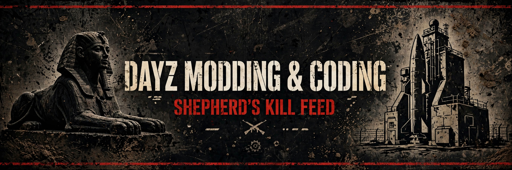

# Shepherd's Kill Feed

**The all-in-one kill feed bot for DayZ — built for console and PC alike.**

Shepherd's Kill Feed reads your server's log and posts the action straight into your Discord: kills, deaths, streaks and fights as they happen, with stats and leaderboards your players will actually check.

## What it does

- Kill feed and death reports, posted live to your Discord
- Player stats, rank ladder and leaderboards — daily, weekly, all-time
- Heat maps of where the action happens on your map
- Server economy: wallets, a shop, bounties, contracts and a casino
- Factions with their own banks and colours
- Base zones, raid alerts and safe-zone warnings
- One-command install — the bot builds its own channel layout and sets itself up

## The pilot — ten spots

We're opening Shepherd's Kill Feed to **ten console servers** for pilot testing, in waves. Console servers on Nitrado with 32+ slots and 20+ players on daily qualify — bring a screenshot of your player listing.

PC servers: you're next — PC testing opens once the console pilot closes, and PC owners can put their name down now in the Discord.

## Get it

Shepherd's Kill Feed lives in our Discord — that's where you claim a pilot spot, ask questions, and get the bot:

**Join the Discord: https://discord.gg/pyQUmWv8nh**

See it in action: [the Shepherd's Kill Feed page](https://kingshepherd-bot.github.io/KingShepherd-bot/)

---

From the **DayZ Modding & Coding** team — DayZ server help for console & PC.
